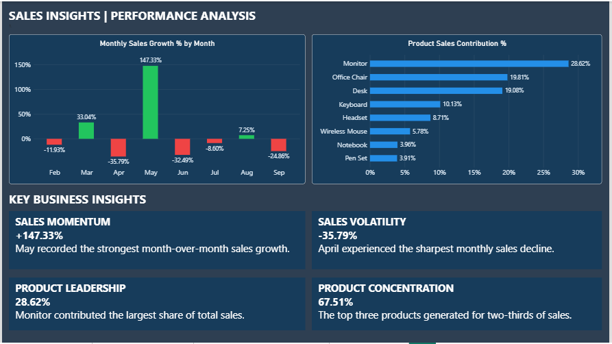

# Sales Performance Analysis | Power BI

An interactive **Power BI portfolio project** analyzing sales trends, product performance, regional results, and profitability using a synthetic retail sales dataset.

> **Dataset Notice:** All data is synthetic and used for educational and portfolio demonstration purposes. Findings do not represent a real company's performance.

## Dashboard Preview

### 1. Executive Sales Overview


An executive dashboard featuring total sales, total profit, profit margin, order volume, monthly sales trends, product performance, and regional comparisons. Interactive slicers enable analysis by date, region, and category.

### 2. Profitability Analysis


This page analyzes product profitability, profit margins, regional performance, and sales versus profit by category.

### 3. Sales Insights & Performance



This page highlights month-over-month sales growth, product sales contribution, sales volatility, and product concentration.

**Note:** The business insight text cards summarize the unfiltered dataset and are static. Charts respond to report filters.

### 4. Data Model


The model uses a **star schema**, with Sales as the fact table and Date, Product, and Region as dimension tables.

## Project Objectives

- Track sales, cost, profit, profit margin, and order volume.
- Analyze monthly sales trends and month-over-month growth.
- Compare performance across products, categories, and regions.
- Evaluate profitability and profit-margin efficiency.
- Measure individual product contributions to total sales.
- Enable interactive analysis through report slicers.

## Tools and Skills

- **Power BI Desktop:** Interactive dashboards, KPI cards, and data visualization.
- **Power Query:** Data cleaning, type validation, and date transformation.
- **DAX:** Financial measures, time intelligence, growth rates, and contribution analysis.
- **Data Modeling:** Star schema and relationships.
- **Business Analysis:** KPI interpretation, trend analysis, and recommendations.

## Dataset

The project uses **50 synthetic sales records** covering January–September 2026.

The dataset includes:

- **Regions:** Jeddah, Dammam, Riyadh, and Makkah.
- **Categories:** Electronics, Furniture, and Office Supplies.
- **Fields:** `OrderID`, `OrderDate`, `Region`, `Category`, `Product`, `Quantity`, `UnitPrice`, and `UnitCost`.

The original CSV uses the **MM/DD/YYYY** date format.

## Key DAX Measures

```dax
Total Sales =
SUMX(Sales, Sales[Quantity] * Sales[UnitPrice])

Total Cost =
SUMX(Sales, Sales[Quantity] * Sales[UnitCost])

Total Profit =
[Total Sales] - [Total Cost]

Profit Margin % =
DIVIDE([Total Profit], [Total Sales], 0)

Total Orders =
DISTINCTCOUNT(Sales[OrderID])

Average Order Value =
DIVIDE([Total Sales], [Total Orders], 0)
```

### Time Intelligence

```dax
Previous Month Sales =
CALCULATE(
    [Total Sales],
    DATEADD('Date'[Date], -1, MONTH)
)

Monthly Sales Growth % =
VAR CurrentSales = [Total Sales]
VAR PreviousSales = [Previous Month Sales]
RETURN
    IF(
        ISBLANK(PreviousSales) || PreviousSales = 0,
        BLANK(),
        DIVIDE(CurrentSales - PreviousSales, PreviousSales)
    )
```

### Product Sales Contribution

```dax
Product Sales Contribution % =
DIVIDE(
    [Total Sales],
    CALCULATE(
        [Total Sales],
        REMOVEFILTERS('Product')
    ),
    0
)
```

Additional measures support regional sales contribution, profit contribution, and conditional formatting.

## Key Findings

*The figures below reflect the complete synthetic dataset without region or category filters.*

| KPI | Result |
|---|---:|
| Total Sales | 27,254.50 |
| Total Cost | 17,092.00 |
| Total Profit | 10,162.50 |
| Profit Margin | 37.29% |
| Total Orders | 50 |
| Average Order Value | 545.09 |

### Sales Performance Insights

- **May** recorded the strongest month-over-month sales growth (**+147.33%**).
- **April** experienced the sharpest monthly sales decline (**-35.79%**).
- Monthly growth is calculated against the preceding month. January has no preceding month in the dataset.

### Product Insights

- **Monitor** generated the largest share of total sales (**28.62%**).
- **Office Chair** contributed **19.81%**, followed by **Desk** at **19.08%**.
- The top three products generated approximately **67.5%** of total sales.
- **Office Chair** generated the highest total profit (**1,920**), followed by **Monitor** (**1,900**) and **Desk** (**1,760**).
- **Notebook** achieved the highest profit margin (**64.71%**), followed by **Pen Set** (**60.00%**).
- A product with high total profit does not necessarily have the highest profit margin.

### Regional Insights

- **Jeddah** generated the highest total profit (approximately **2,926**).
- **Dammam** followed with approximately **2,742**.
- **Riyadh** generated approximately **2,445**.
- **Makkah** generated approximately **2,050**.

*Chart labels may be rounded and therefore may not sum exactly to unrounded totals.*

## Business Recommendations

1. Evaluate both total profit and profit margin when prioritizing products.
2. Explore opportunities to increase sales of high-margin products while considering demand and volume.
3. Investigate the factors behind regional profit differences.
4. Monitor month-over-month sales trends and investigate unusual changes.
5. Monitor sales concentration among the highest-contributing products.

## Repository Structure

```text
Sales-Performance-Analysis-PowerBI/
├── README.md
├── Sales_Performance_Analysis_Professional.pbix
├── powerbi_sales_project_data.csv
├── Page_1.png
├── Page_2.png
├── Page_3.png
└── Model_View.png
```

## How to Explore the Report

1. Download the `.pbix` file and the CSV dataset.
2. Open the report in **Microsoft Power BI Desktop**.
3. If Power BI cannot locate the CSV, go to **Home → Transform data** and update the `Source` step in the `Sales` query.
4. If date conversion fails, select **Change Type → Using Locale**, choosing **Date** and **English (United States)**.
5. Select **Close & Apply** and refresh the report.
6. Navigate between **Executive Sales Overview**, **Profitability Analysis**, and **Sales Insights & Performance**.
7. Use the available slicers to explore sales and profitability. Clear selections to return to the full-dataset figures.

## Project Scope

This is a learning and portfolio project using synthetic data. It demonstrates data preparation, dimensional modeling, DAX calculations, dashboard design, time intelligence, and interpretation of business performance.
