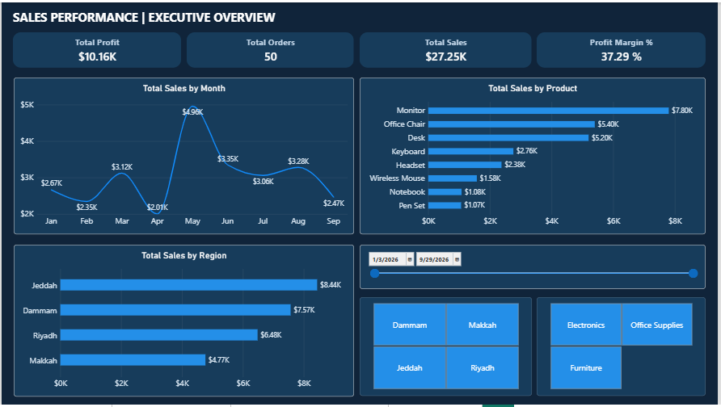
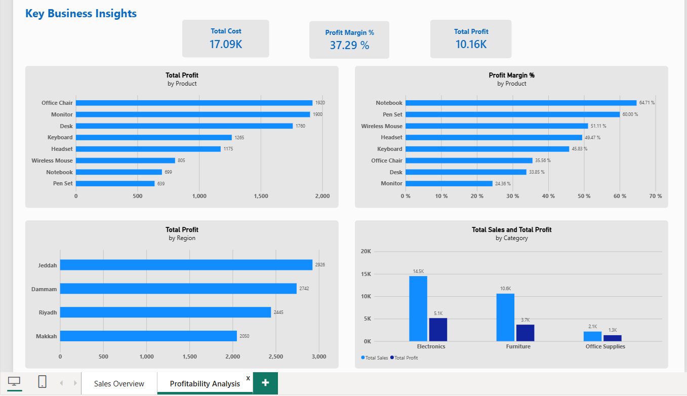
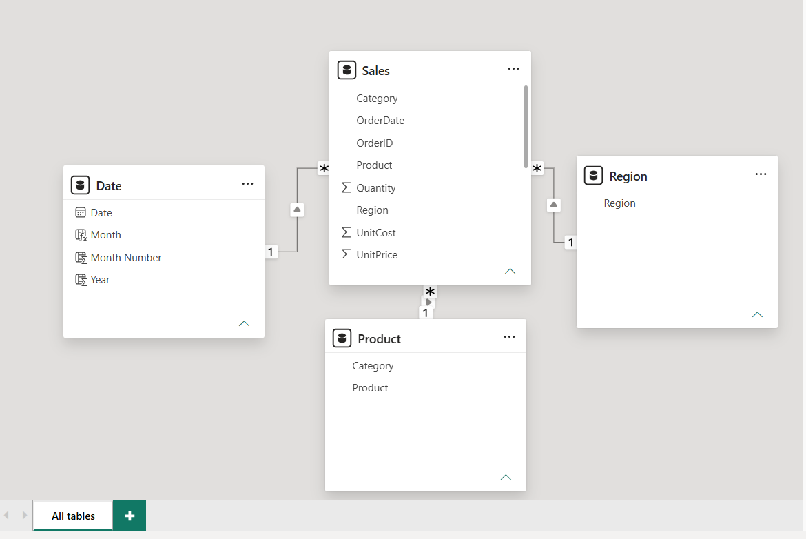

# Sales Performance Analysis | Power BI

An interactive **Power BI portfolio project** analyzing sales trends, product performance, regional results, and profitability using a synthetic retail sales dataset.

> **Dataset notice:** All data is synthetic and used for educational and portfolio demonstration purposes. Findings do not represent a real company's performance.


## Dashboard Preview

### 1. Sales Overview



The dashboard displays sales KPIs, monthly trends,
product performance, and regional comparisons.

### 2. Profitability Analysis



This page analyzes product profitability, profit margins,
regional performance, and category comparisons.

### 3. Data Model



The model uses a star schema with Sales as the fact table
and Date, Product, and Region as dimension tables.

## Project Objectives

- Track revenue, cost, profit, profit margin, and order volume.
- Analyze monthly sales patterns.
- Compare performance across products, categories, and regions.
- Distinguish total profit from profit-margin efficiency.
- Enable self-service analysis through interactive filters.

## Tools and Skills

- **Power BI Desktop:** interactive dashboards and data visualization
- **Power Query:** data inspection, type validation, and preparation
- **DAX:** measures for revenue, costs, profitability, and order metrics
- **Data Modeling:** fact/dimension design and relationships
- **Business Analysis:** KPI interpretation and actionable recommendations

## Dataset

The project uses **50 synthetic sales records** covering January–September 2026, four regions (Jeddah, Dammam, Riyadh, and Makkah), and three categories (Electronics, Furniture, and Office Supplies).

Source fields include `OrderID`, `OrderDate`, `Region`, `Category`, `Product`, `Quantity`, `UnitPrice`, and `UnitCost`.

## Key DAX Measures

```dax
Total Sales =
SUMX(Sales, Sales[Quantity] * Sales[UnitPrice])

Total Cost =
SUMX(Sales, Sales[Quantity] * Sales[UnitCost])

Total Profit =
[Total Sales] - [Total Cost]

Profit Margin % =
DIVIDE([Total Profit], [Total Sales], 0)

Total Orders =
DISTINCTCOUNT(Sales[OrderID])

Average Order Value =
DIVIDE([Total Sales], [Total Orders], 0)
```

The report also includes sales-contribution and profit-contribution measures for filtered analysis.

## Key Findings

*The figures below reflect the complete synthetic dataset with no region or category filters applied.*

| KPI | Result |
|---|---:|
| Total Sales | 27,254.50 |
| Total Cost | 17,092.00 |
| Total Profit | 10,162.50 |
| Profit Margin | 37.29% |
| Total Orders | 50 |
| Average Order Value | 545.09 |

### Product Insights

- **Office Chair** generated the highest total profit (**1,920**), followed by **Monitor** (**1,900**) and **Desk** (**1,760**).
- **Notebook** achieved the highest profit margin (**64.71%**), followed by **Pen Set** (**60.00%**).
- A product with a high total profit is not necessarily the product with the highest profit margin.

### Regional Insights

- **Jeddah** generated the highest total profit (approximately **2,926**).
- **Dammam** followed with approximately **2,742**, then **Riyadh** (**2,445**) and **Makkah** (**2,050**).

*Individual chart labels are rounded; displayed regional values may not sum exactly to the unrounded total.*

## Business Recommendations

1. Evaluate both total profit and profit margin before prioritizing products.
2. Explore opportunities to increase sales of high-margin products, while considering demand and volume.
3. Investigate the factors behind regional profit differences rather than assuming the highest-profit region is the most efficient.
4. Monitor monthly sales trends and investigate unusual changes.


Sales-Performance-Analysis-PowerBI/
├── README.md
├── Sales Analysis Projict.pbix
├── powerbi_sales_project_data.csv
├── Page_1.png
├── Page_2.png
└── Model_View.png


## How to Explore the Report

1. Download `Sales Analysis Projict.pbix` from this repository.
2. Open it in **Microsoft Power BI Desktop**.
3. Navigate between **Sales Overview** and **Profitability Analysis**.
4. Use the available filters to explore sales and profitability by date, region, and category.
5. Clear filters to return to the full-dataset figures shown above.

## Project Scope

This is a learning and portfolio project using synthetic data. It demonstrates data preparation, dimensional modeling, DAX calculations, dashboard design, and interpretation of business performance.
